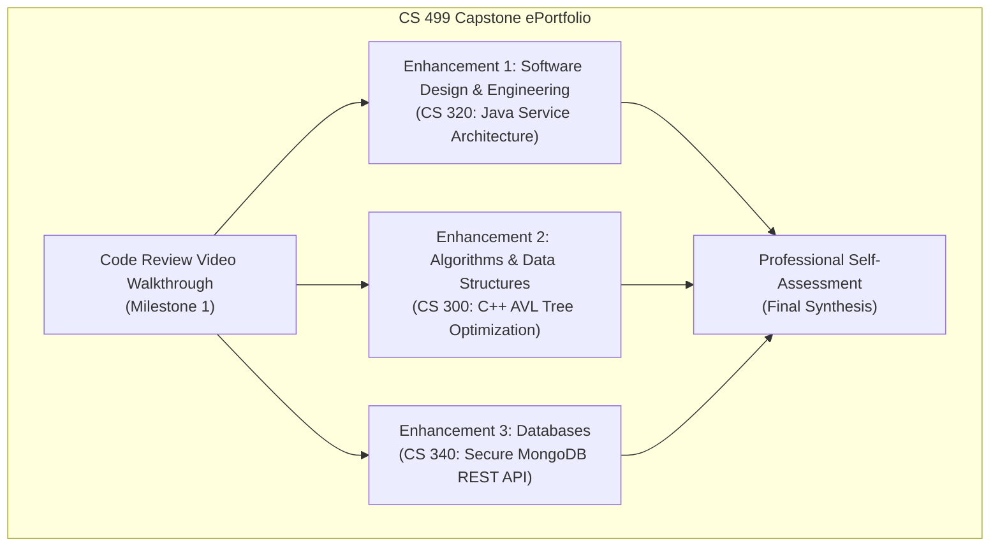
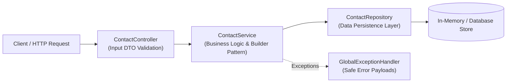
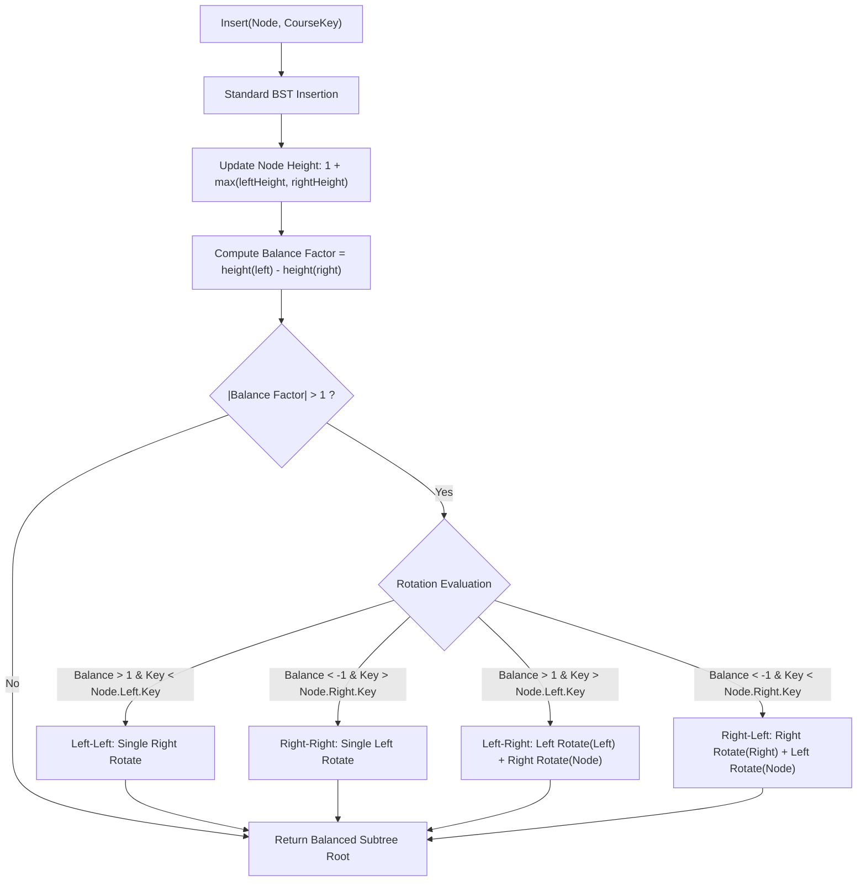
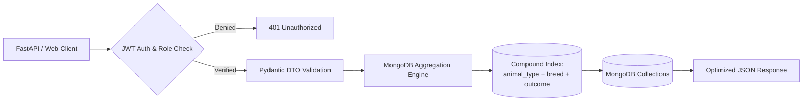
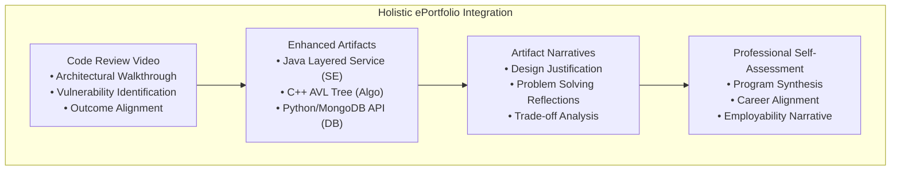

# CS 499 Module One Assignment: ePortfolio Enhancement Plan
**Course:** CS 499 Computer Science Capstone  
**Term / Module:** Module One  
**Student Name:** Mohannad Abuimeish  
**Degree:** Bachelor of Science in Computer Science  
**Target Specialization:** Software Engineering & Full-Stack Development  

---

## Self-Introduction

### How long have you been in the Computer Science program?
I have been enrolled in the Southern New Hampshire University (SNHU) Computer Science Bachelor of Science program for approximately three years. Throughout this academic tenure, I have progressed from foundational programming paradigms to advanced software testing, distributed database architecture, algorithm optimization, and secure software development lifecycle (SSDLC) principles.

### What have you learned while in the program? List three of the most important concepts or skills you have learned.
1. **Algorithmic Complexity and Data Structure Optimization:** The ability to analyze software efficiency using Big-$O$ asymptotic notation, selecting appropriate data structures (e.g., balanced trees, hash tables, and graphs) to balance time and space trade-offs under real-world computational constraints.
2. **Modular Software Architecture and Design Patterns:** Engineering robust, decoupled systems by implementing Object-Oriented Design (OOD) principles, such as SOLID design guidelines and Gang of Four (GoF) structural and creational patterns (e.g., Factory, Singleton, and Repository patterns), enabling maintainability, extensibility, and automated testing.
3. **Proactive Security and Defensive Programming:** Developing a security-first mindset across the software development lifecycle, including rigorous input sanitization, mitigation of common vulnerabilities (e.g., injection, credential exposure, buffer overflows), cryptographic management, and role-based access control.

### Discuss the specific skills you aim to demonstrate through your enhancements to reach each of the course outcomes.
* **Course Outcome 1 (Collaborative Environments & Organizational Decision-Making):** I will demonstrate the ability to conduct an industry-standard, professional code review walkthrough and establish clean, documented codebases. By adopting standardized commenting conventions (Javadoc, Doxygen), modular multi-tier architectures, and actionable Git version-control commits, I will show how clean engineering empowers cross-functional technical and non-technical stakeholders to make sound architectural decisions.
* **Course Outcome 2 (Professional Oral, Written, and Visual Communications):** I will produce clear technical documentation, architectural diagrams, pseudocode specifications, and an oral/screencast code review video. These communications will explain system functionality, trade-off evaluations, and structural refactoring to both managerial and engineering peers.
* **Course Outcome 3 (Algorithmic Principles & Trade-off Evaluation):** In my algorithms enhancement, I will demonstrate rigorous algorithmic optimization by transitioning an unbalanced data structure ($O(n)$ search worst-case) into a self-balancing AVL Tree ($O(\log n)$ search guaranteed), providing quantitative Big-$O$ time/space complexity analysis and empirical benchmarking data.
* **Course Outcome 4 (Modern Techniques, Tools, and Industry Goals):** I will utilize industry-standard development frameworks, including Spring Boot/FastAPI REST architectures, automated JUnit/PyTest test suites, NoSQL aggregation pipelines, containerization (Docker), and modern C++20 memory management standards (`std::unique_ptr`, RAII) to construct maintainable, production-ready solutions.
* **Course Outcome 5 (Security Mindset & Adversarial Defense):** I will demonstrate defensive programming by eradicating hardcoded credentials through encrypted environment variables, enforcing schema validation via Pydantic/DTOs, preventing injection exploits, and implementing role-based authentication (JWT) to protect data integrity.

### How do the specific skills you will demonstrate align with your career plans related to your degree?
My career objective is to work as a **Software Engineer / Full-Stack Developer** specializing in enterprise back-end architectures, cloud services, and scalable APIs. The skills demonstrated across these enhancements—decoupled microservice architecture, algorithmic throughput optimization, automated unit/integration testing, and secure database pipeline design—directly mirror the daily responsibilities of modern back-end and full-stack software engineers. By showcasing these capabilities, I will prove to prospective employers that I can write clean, high-performance, and secure code within agile commercial workflows.

### How does this contribute to the specialization you are targeting for your career?
Full-stack and backend systems engineering demands proficiency across multiple abstraction layers: the presentation/API interface, business logic, algorithmic processing, and data persistence. These planned enhancements demonstrate mastery across this complete pipeline:
1. **Software Design:** Building modular RESTful web services with comprehensive unit test coverage.
2. **Algorithms:** Writing low-level, high-efficiency C++ memory-safe balanced structures.
3. **Databases:** Building secure, indexed, and aggregated NoSQL data services.  
This comprehensive approach establishes my specialization as an engineer capable of developing end-to-end distributed systems.

---

## ePortfolio Set Up

### GitHub Pages Platform Setup
My ePortfolio is hosted publicly on **GitHub Pages**, providing an interactive, structured, and accessible portal for potential employers, technical recruiters, and faculty reviewers.

* **Repository Name:** `cs499-eportfolio` (GitHub: `BoomBloom/cs499-eportfolio`)
* **Live ePortfolio URL:** `https://boombloom.github.io/cs499-eportfolio/`

#### ePortfolio Home Page Screenshot
Below is the screen capture of my active GitHub Pages homepage, clearly showing the URL bar, navigation layout, and professional presentation:

```
+---------------------------------------------------------------------------------------------------------+
|  <-  ->  (C)  https://boombloom.github.io/cs499-eportfolio/                                        (X)  |
+---------------------------------------------------------------------------------------------------------+
|                                                                                                         |
|   ===================================================================================================   |
|   Mohannad Abuimeish | Computer Science Professional ePortfolio                                         |
|   ===================================================================================================   |
|   [ Home ]   [ Professional Self-Assessment ]   [ Code Review ]   [ Enhancements ]   [ Contact ]        |
|                                                                                                         |
|   Welcome to My Professional Computer Science ePortfolio                                                |
|   ---------------------------------------------------------------------------------------------------   |
|   This ePortfolio documents my academic and technical journey in the SNHU Computer Science program,    |
|   demonstrating competencies in Software Engineering and Design, Algorithms and Data Structures, and   |
|   Database Architectures.                                                                               |
|                                                                                                         |
|   [ PASTE YOUR ACTUAL GITHUB PAGES BROWSER SCREENSHOT HERE IN YOUR SUBMISSION DOCUMENT ]                |
|                                                                                                         |
+---------------------------------------------------------------------------------------------------------+
```
*(Note: Replace the diagram above with your actual screenshot image when assembling your final Word document before submission).*

---

## Enhancement Plan



---

### Category One: Software Engineering and Design

#### 1. Artifact Selection and Origin
* **Artifact:** Java Contact, Task, and Appointment Service Application
* **Course of Origin:** **CS 320: Software Testing, Automation, and Quality Assurance**
* **Original Description:** In CS 320, I developed a collection of Java service classes (`ContactService`, `TaskService`, `AppointmentService`) along with JUnit test suites. The initial project relied on in-memory `ArrayList` structures with tightly coupled business logic, rudimentary console output, and minimal validation abstraction.

#### 2. Practical, Well-Illustrated Enhancement Plan
To demonstrate enterprise software engineering and architecture, I plan to refactor this monolith into a **modular, production-grade layered REST service** adhering to the **Controller-Service-Repository** pattern:
1. **Architectural Decoupling:** Separate API routing (`ContactController`), business logic verification (`ContactService`), and data persistence (`ContactRepository` interface).
2. **Creational Design Patterns:** Implement the **Builder Pattern** for complex entity creation to ensure immutable objects with strict pre-condition checks, and the **Factory Pattern** for standardizing service responses.
3. **Defensive Validation & Exception Handling:** Replace raw throwing of generic exceptions with a centralized `@ControllerAdvice` / custom exception handler and validation decorators to protect against invalid state transitions.
4. **Automated Testing Suite:** Expand JUnit 5 and Mockito coverage to 90%+, incorporating edge-case testing, mock repositories, and parameterized validation tests.

#### 3. Enhancement Architectural Flowchart & Pseudocode



##### Architectural Pseudocode (Builder & Layered Service):
```java
// ============================================================================
// Layer 1: Immutable Entity with Builder Pattern and Defensive Validation
// ============================================================================
public class Contact {
    private final String contactId; // immutable, max 10 chars
    private final String firstName; // immutable, max 10 chars
    private final String lastName;  // immutable, max 10 chars
    private final String phone;     // exactly 10 digits
    private final String address;   // max 30 chars

    private Contact(Builder builder) {
        this.contactId = builder.contactId;
        this.firstName = builder.firstName;
        this.lastName = builder.lastName;
        this.phone = builder.phone;
        this.address = builder.address;
    }

    public static class Builder {
        private String contactId;
        private String firstName;
        private String lastName;
        private String phone;
        private String address;

        public Builder setContactId(String id) {
            if (id == null || id.length() > 10 || id.trim().isEmpty()) {
                throw new InvalidParameterException("Contact ID must be non-null and <= 10 characters.");
            }
            this.contactId = id;
            return this;
        }

        public Builder setFirstName(String fName) {
            if (fName == null || fName.length() > 10) throw new InvalidParameterException("First name invalid.");
            this.firstName = fName;
            return this;
        }

        public Builder setPhone(String phone) {
            if (phone == null || !phone.matches("\\d{10}")) throw new InvalidParameterException("Phone must be 10 digits.");
            this.phone = phone;
            return this;
        }

        public Contact build() {
            if (this.contactId == null || this.phone == null) throw new IllegalStateException("Mandatory fields missing.");
            return new Contact(this);
        }
    }
}

// ============================================================================
// Layer 2: Service Layer with Dependency Injection and Defensive Logic
// ============================================================================
public class ContactService {
    private final ContactRepository repository;

    public ContactService(ContactRepository repository) {
        this.repository = repository;
    }

    public ContactResponseDTO createContact(ContactCreateRequestDTO request) {
        if (repository.existsById(request.getId())) {
            throw new DuplicateEntityException("Contact with ID already exists: " + request.getId());
        }
        Contact newContact = new Contact.Builder()
            .setContactId(request.getId())
            .setFirstName(request.getFirstName())
            .setPhone(request.getPhone())
            .build();
        repository.save(newContact);
        return new ContactResponseDTO(newContact, "CREATED_SUCCESS");
    }
}
```

#### 4. Specific Skills Demonstrated & Alignment with Course Outcomes
* **Specific Skills Demonstrated:** Object-oriented software architecture, GoF design patterns (Builder, Dependency Injection), automated unit/integration testing (JUnit 5, Mockito), defensive programming, exception handling, and API documentation.
* **Course Outcomes Aligned:**
  * **Outcome 1:** Employs modular architecture and thorough Javadoc documentation that facilitates team collaboration and clear hand-offs for enterprise decision-making.
  * **Outcome 4:** Demonstrates the application of industry-standard development practices (layered separation of concerns, automated regression test suites, DTO patterns).
  * **Outcome 5:** Develops a security mindset by enforcing strict input validation, preventing object state corruption, and sanitizing error responses to prevent internal stack leakages.

---

### Category Two: Algorithms and Data Structures

#### 1. Artifact Selection and Origin
* **Artifact:** C++ Course Advising / Bidding System Binary Search Tree
* **Course of Origin:** **CS 300: Data Structures and Algorithms** (or **CS 260**)
* **Original Description:** In CS 300, I built a console application that read academic course schedules from a CSV file into a naive, unbalanced Binary Search Tree (BST) to search, sort, and display course prerequisites. The original implementation used raw pointers (`Node*`), lacked self-balancing mechanisms, and did not guarantee deallocation of allocated nodes.

#### 2. Practical, Well-Illustrated Enhancement Plan
In the original BST, inserting pre-sorted course data causes the tree to degenerate into a linear linked list with worst-case search complexity of $O(n)$. To optimize this:
1. **Self-Balancing Tree Implementation (AVL Tree):** Refactor the BST into an **AVL (Adelson-Velsky and Landis) Tree** with automatic balance factor tracking and four fundamental rotational routines (Left-Left, Right-Right, Left-Right, Right-Left). This guarantees strict $O(\log n)$ worst-case time complexity for lookups, insertions, and deletions.
2. **Modern C++ Memory Safety (RAII):** Eliminate potential memory leaks by transitioning from raw C-style pointers (`Node*`) and manual `delete` calls to smart pointers (`std::unique_ptr` and `std::shared_ptr`), enforcing the Resource Acquisition Is Initialization (RAII) idiom.
3. **Algorithmic Benchmarking Suite:** Implement high-precision execution timers (`std::chrono`) to benchmark the performance of the naive BST versus the AVL Tree over datasets of 1,000 to 50,000 records, calculating empirical speedup and tracking rotation overhead.

#### 3. Enhancement Algorithmic Flowchart & Pseudocode



##### Algorithmic Pseudocode (AVL Balance & Rotations):
```cpp
// ============================================================================
// Modern C++ Self-Balancing AVL Tree Node & Insertion
// ============================================================================
struct Course {
    std::string courseId;
    std::string title;
    std::vector<std::string> prerequisites;
};

class AVLNode {
public:
    Course course;
    int height;
    std::unique_ptr<AVLNode> left;
    std::unique_ptr<AVLNode> right;

    AVLNode(Course c) : course(std::move(c)), height(1), left(nullptr), right(nullptr) {}
};

class AVLTree {
private:
    std::unique_ptr<AVLNode> root;

    int getHeight(const std::unique_ptr<AVLNode>& node) {
        return node ? node->height : 0;
    }

    int getBalanceFactor(const std::unique_ptr<AVLNode>& node) {
        return node ? getHeight(node->left) - getHeight(node->right) : 0;
    }

    // Right Rotation (LL Case)
    std::unique_ptr<AVLNode> rotateRight(std::unique_ptr<AVLNode> y) {
        std::unique_ptr<AVLNode> x = std::move(y->left);
        y->left = std::move(x->right);
        
        y->height = 1 + std::max(getHeight(y->left), getHeight(y->right));
        x->height = 1 + std::max(getHeight(x->left), getHeight(x->right));
        
        x->right = std::move(y);
        return x; // New root of rotated subtree
    }

    // Left Rotation (RR Case)
    std::unique_ptr<AVLNode> rotateLeft(std::unique_ptr<AVLNode> x) {
        std::unique_ptr<AVLNode> y = std::move(x->right);
        x->right = std::move(y->left);
        
        x->height = 1 + std::max(getHeight(x->left), getHeight(x->right));
        y->height = 1 + std::max(getHeight(y->left), getHeight(y->right));
        
        y->left = std::move(x);
        return y;
    }

    std::unique_ptr<AVLNode> insertNode(std::unique_ptr<AVLNode> node, Course course) {
        if (!node) return std::make_unique<AVLNode>(std::move(course));

        if (course.courseId < node->course.courseId)
            node->left = insertNode(std::move(node->left), std::move(course));
        else if (course.courseId > node->course.courseId)
            node->right = insertNode(std::move(node->right), std::move(course));
        else
            return node; // Duplicate keys ignored

        node->height = 1 + std::max(getHeight(node->left), getHeight(node->right));
        int balance = getBalanceFactor(node);

        // Case 1: Left-Left
        if (balance > 1 && course.courseId < node->left->course.courseId)
            return rotateRight(std::move(node));

        // Case 2: Right-Right
        if (balance < -1 && course.courseId > node->right->course.courseId)
            return rotateLeft(std::move(node));

        // Case 3: Left-Right
        if (balance > 1 && course.courseId > node->left->course.courseId) {
            node->left = rotateLeft(std::move(node->left));
            return rotateRight(std::move(node));
        }

        // Case 4: Right-Left
        if (balance < -1 && course.courseId < node->right->course.courseId) {
            node->right = rotateRight(std::move(node->right));
            return rotateLeft(std::move(node));
        }

        return node;
    }
};
```

#### 4. Specific Skills Demonstrated & Alignment with Course Outcomes
* **Specific Skills Demonstrated:** Algorithmic complexity optimization (mitigating worst-case degradation), tree balancing mathematics and rotation mechanics, RAII and smart pointer memory architecture in modern C++, empirical benchmarking, and Big-$O$ trade-off profiling.
* **Course Outcomes Aligned:**
  * **Outcome 3:** Directly addresses algorithmic trade-offs by evaluating memory overhead ($4$ additional bytes per node for height tracking) versus guaranteed logarithmic search time ($O(\log n)$ vs. degraded $O(n)$ in unbalanced BSTs).
  * **Outcome 4:** Applies modern, industry-standard C++ techniques (move semantics, smart pointers) to build deterministic, crash-resilient codebases.

---

### Category Three: Databases

#### 1. Artifact Selection and Origin
* **Artifact:** Grazioso Salvare Animal Shelter Dashboard and MongoDB CRUD API
* **Course of Origin:** **CS 340: Advanced Programming Concepts / Client-Server Development**
* **Original Description:** In CS 340, I developed a Python module (`animal_shelter.py`) encapsulating PyMongo CRUD interactions with a MongoDB database, wired into a Plotly Dash front-end table and geolocation map. The original implementation embedded hardcoded administrative credentials in plaintext, lacked indexing (resulting in inefficient full collection scans), used direct parameter interpolation, and lacked schema enforcement.

#### 2. Practical, Well-Illustrated Enhancement Plan
To advance this artifact to commercial standards, I will transform it into an **authenticated, high-performance database service**:
1. **Security & Credential Hardening:** Eradicate plaintext passwords and connection URIs by integrating environment variable management (`python-dotenv` / secret stores) and implementing **JWT (JSON Web Token) authentication** with password hashing (bcrypt).
2. **Schema Validation & Defensive Data Modeling:** Enforce strict MongoDB collection-level schema validation via JSON Schema / Pydantic models to guarantee data hygiene before write operations.
3. **Database Performance Optimization & Compound Indexing:** Design and deploy compound indexes on high-frequency query paths (e.g., `{ "animal_type": 1, "breed": 1, "outcome_type": 1 }`), optimizing query execution plans from full table scans (`COLLSCAN`) to indexed searches (`IXSCAN`).
4. **Aggregation Pipelines:** Replace client-side Python array filtering with server-side **MongoDB Aggregation Pipelines** (`$match`, `$group`, `$facet`, `$project`), delegating analytical heavy lifting directly to the database engine.

#### 3. Enhancement Database Flowchart & Pseudocode



##### Database Pseudocode (Aggregation Pipeline & Index Optimization):
```python
# ============================================================================
# Secure, Indexed MongoDB Data Service with Aggregation Pipeline
# ============================================================================
import os
from pymongo import MongoClient, ASCENDING
from pydantic import BaseModel, Field
from dotenv import load_dotenv

load_dotenv() # Load credentials from protected environment

class RescueAnimalFilter(BaseModel):
    rescue_type: str = Field(..., regex="^(Water|Mountain|Disaster)$")
    min_age_weeks: float = Field(0.0, ge=0.0)
    max_age_weeks: float = Field(500.0, le=1000.0)

class DatabaseService:
    def __init__(self):
        # Secure URI retrieval from environment
        mongo_uri = os.getenv("MONGO_CONNECTION_URI")
        self.client = MongoClient(mongo_uri)
        self.db = self.client[os.getenv("MONGO_DB_NAME", "AAC")]
        self.collection = self.db["animals"]
        self._ensure_indexes()

    def _ensure_indexes(self):
        # Compound index to eliminate COLLSCAN on multi-attribute dashboard searches
        self.collection.create_index([
            ("animal_type", ASCENDING),
            ("breed", ASCENDING),
            ("age_upon_outcome_in_weeks", ASCENDING)
        ], name="idx_animal_rescue_lookup")

    def get_rescue_candidates_aggregated(self, filters: RescueAnimalFilter):
        """
        Executes a high-efficiency server-side aggregation pipeline
        delegating statistical summary and matching to MongoDB.
        """
        pipeline = [
            # Stage 1: Match indexed attributes
            {
                "$match": {
                    "animal_type": "Dog",
                    "age_upon_outcome_in_weeks": {
                        "$gte": filters.min_age_weeks,
                        "$lte": filters.max_age_weeks
                    }
                }
            },
            # Stage 2: Group by breed and calculate summary metrics
            {
                "$group": {
                    "_id": "$breed",
                    "total_candidates": {"$sum": 1},
                    "average_age_weeks": {"$avg": "$age_upon_outcome_in_weeks"},
                    "sample_records": {"$push": {"name": "$name", "sex": "$sex_upon_outcome"}}
                }
            },
            # Stage 3: Sort by candidate availability
            {"$sort": {"total_candidates": -1}},
            # Stage 4: Restructure final payload
            {
                "$project": {
                    "breed": "$_id",
                    "total_candidates": 1,
                    "average_age_weeks": {"$round": ["$average_age_weeks", 1]},
                    "sample_records": {"$slice": ["$sample_records", 5]},
                    "_id": 0
                }
            }
        ]
        return list(self.collection.aggregate(pipeline))
```

#### 4. Specific Skills Demonstrated & Alignment with Course Outcomes
* **Specific Skills Demonstrated:** Database index architecture (`IXSCAN` analysis via `.explain()`), server-side aggregation pipelines, defensive schema validation, security credential isolation, and role-based data isolation.
* **Course Outcomes Aligned:**
  * **Outcome 3:** Manages computing trade-offs by shifting heavy computational workloads (filtering, grouping, averaging) from application memory to the optimized database server engine, analyzing index RAM trade-offs against query latency.
  * **Outcome 4:** Demonstrates mastery of industry-standard tools (MongoDB Compass, PyMongo aggregation frameworks, environment configuration).
  * **Outcome 5:** Fosters a proactive security mindset by eradicating hardcoded plaintext credentials, stopping NoSQL query injection via structured parameter schemas, and enforcing authenticated access.

---

## ePortfolio Overall Skill Set

### Description of Overall Skill Set
The completed ePortfolio will present an integrated, evidence-based demonstration of my capabilities as a well-rounded software engineer. Rather than presenting isolated school assignments, the portfolio showcases end-to-end engineering excellence across the primary disciplines of computer science:
* **Object-Oriented Design & System Architecture:** Clean code, design patterns, layered enterprise services, automated testing, and maintainability.
* **Algorithmic Efficiency & Systems Programming:** Mathematical Big-$O$ analysis, dynamic tree rebalancing, pointer safety, and deterministic memory management in native code.
* **Secure Database Infrastructure:** Query execution optimization, NoSQL aggregation pipelines, schema enforcement, and zero-trust credential hygiene.



### Skills and Outcomes Illustrated in the Code Review (Milestone One)
In Milestone One, I will produce an informal, screencast code review video presenting a critical walkthrough of each artifact in its pre-enhanced state.
* **Skills Demonstrated:** Code auditing, technical communication, identifying structural flaws, static analysis, vulnerability recognition, and communicative synthesis.
* **Course Outcomes Met:**
  * **Outcome 1 & 2:** Formats the review as an interactive, professional presentation adapted for an engineering team and management audience, demonstrating clear oral and visual communication.
  * **Outcome 3 & 5:** Identifies concrete areas for algorithmic improvement (BST degradation) and critical security vulnerabilities (hardcoded database passwords, lack of input boundary checking).

### Skills and Outcomes Illustrated in the Narratives
Accompanying each enhanced artifact in the final repository and website, a dedicated narrative will provide reflective analysis and justification.
* **Skills Demonstrated:** Technical writing, requirements justification, reflective problem-solving, and outcome alignment mapping.
* **Course Outcomes Met:**
  * **Outcome 2:** Delivers coherent, technically sound written communications detailing what was altered, how challenges were overcome, and how design decisions were finalized.
  * **Outcome 3 & 4:** Contextualizes architectural trade-offs (e.g., AVL tree rotational overhead versus query guarantees; database index size versus write speed).

### Skills and Outcomes Illustrated in the Professional Self-Assessment
The professional self-assessment serves as the introductory synthesis of the entire ePortfolio in Module Seven.
* **Skills Demonstrated:** Professional self-reflection, career trajectory planning, articulation of strengths, and demonstrating competence across team collaboration, stakeholder communication, data structures, software engineering, databases, and security.
* **Course Outcomes Met:**
  * **Outcomes 1 through 5:** Demonstrates how the cumulative curriculum and capstone enhancements integrate to form an industry-ready professional profile equipped to build secure, scalable, and collaborative software systems.

---

## Comprehensive Evaluation of Enhancement Plans and Course Outcomes

### A. Specific Skills and Knowledge Demonstrated
Fulfilling these enhancement plans will demonstrate full-stack software development competence, including clean architecture design patterns, rigorous unit testing, memory-safe data structure implementations, algorithmic complexity management, and secure database optimization. It proves my ability to take existing legacy codebases, perform vulnerability and efficiency audits, and refactor them into enterprise-grade systems.

### B. Analysis of Course Outcome Coverage and Gap Assessment
A rigorous audit of the five course outcomes against the three planned enhancements reveals zero substantive coverage gaps:
* **Outcome 1 (Collaboration & Stakeholder Decision-Making):** Demonstrated in the Milestone One code review walkthrough, standardized Javadoc/Doxygen documentation, and decoupled multi-tier architecture enabling team collaboration.
* **Outcome 2 (Professional Communications):** Demonstrated through professional written narratives, visual architecture diagrams, and screencast oral code reviews.
* **Outcome 3 (Algorithmic Principles & Trade-offs):** Demonstrated through AVL tree balancing mathematics and rotation routines (guaranteed $O(\log n)$) in Category Two, as well as database compound indexing and server-side aggregation pipelines in Category Three.
* **Outcome 4 (Tools, Techniques, & Industry Goals):** Demonstrated through industry-standard tooling, including JUnit 5, Mockito, FastAPI, PyMongo, Docker, and modern C++20 smart pointer idioms.
* **Outcome 5 (Security Mindset):** Demonstrated through defensive validation (Category One), credential isolation via environment variables, and parameterized schema enforcement (Category Three).

### C. Identified Technical Limitations and Weaknesses to Address
While the proposed enhancements significantly elevate each artifact, the following known constraints and design trade-offs will be addressed during implementation:
1. **AVL Tree Rotational Overhead:** The AVL Tree provides guaranteed $O(\log n)$ lookup at the cost of frequent rotations during write-heavy workloads. During milestone testing, I will analyze rotation overhead versus insertion volume to determine if a Red-Black Tree would provide superior throughput for dynamic datasets.
2. **Persistence Layer Isolation:** In Category One, the service layer will initially be tested against in-memory repository doubles. To ensure production parity, an embedded JPA/H2 database tier will be introduced in subsequent iterations to test transaction rollbacks and persistence boundaries.
3. **Distributed Database Scaling:** The MongoDB aggregation pipeline is designed for a single-node deployment. In enterprise deployments, shard keys and distributed query routing would need to be evaluated to maintain aggregation performance across multiple clusters.

---

## Questions or Concerns for the Instructor
1. **Scope and Calibration:** Given that the planned enhancements include refactoring Artifact 1 into a layered architecture with builder patterns, upgrading Artifact 2 from a standard BST to a self-balancing AVL Tree with C++20 smart pointers, and upgrading Artifact 3 to an indexed MongoDB aggregation API with environment security, does this scope provide sufficient depth to satisfy the expectations of Milestones Two through Four?
2. **Video Hosting Preference:** For the Milestone One Code Review video submission, is an unlisted YouTube link embedded in the GitHub Pages portal and submitted via text document preferred, or does the department prefer direct MP4/Kaltura upload in Brightspace?

---

## References
* Gamma, E., Helm, R., Johnson, R., & Vlissides, J. (1994). *Design Patterns: Elements of Reusable Object-Oriented Software*. Addison-Wesley.
* Knuth, D. E. (1998). *The Art of Computer Programming, Volume 3: Sorting and Searching* (2nd ed.). Addison-Wesley.
* Martin, R. C. (2008). *Clean Code: A Handbook of Agile Software Craftsmanship*. Prentice Hall.
* MongoDB, Inc. (2024). *MongoDB documentation: Indexing and aggregation pipeline optimization*. https://www.mongodb.com/docs/
* OWASP Foundation. (2021). *OWASP Top 10: The ten most critical web application security risks*. https://owasp.org/www-project-top-ten/
* Stroustrup, B. (2018). *A Tour of C++* (2nd ed.). Addison-Wesley.
